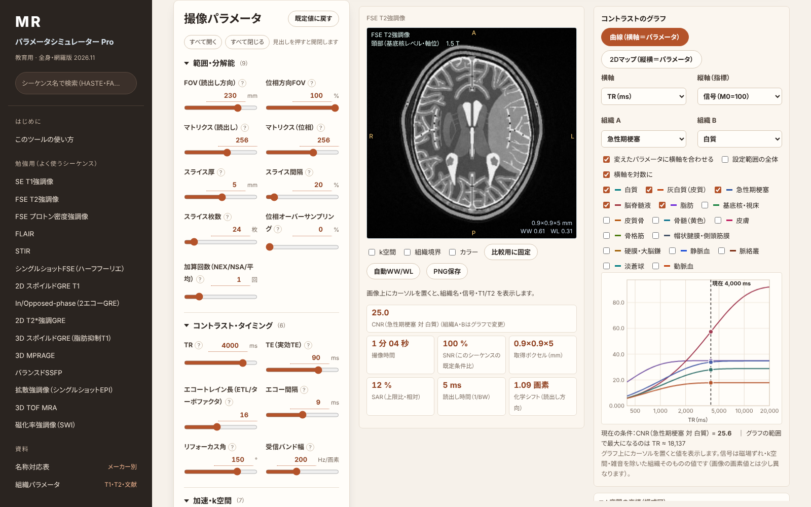

<h1 align="center">MRI Parameter Simulator Pro (whole-body edition)</h1>

<p align="center">
  Change acquisition parameters and watch the <strong>virtual-phantom image, scan time, SNR, SAR and tissue-contrast curves</strong> update instantly.<br>
  An educational MRI simulator in a single HTML file that runs offline.
</p>

<p align="center">
  <a href="https://ringnir.github.io/MRI-SIMULATOR-html/en.html"><strong>▶ Open in the browser</strong></a>
  　|　
  <a href="https://ringnir.github.io/MRI-SIMULATOR-html/en.html#learn"><strong>▶ Learning mode</strong></a>
  　|　
  <a href="README.md">日本語</a> · <a href="README.zh-CN.md">中文</a>
</p>

<p align="center">
  
</p>

> [!WARNING]
> **Educational approximation only. Do not use it for clinical decisions or scanner settings.** Tissue values are rounded literature values or estimates, and the virtual phantoms are analytic schematic drawings. Images, scan time, SNR and SAR do not reproduce any scanner's displayed values. This is not a medical device.

> [!NOTE]
> **Unofficial tool.** Not affiliated with Siemens Healthineers, GE HealthCare, Philips, Canon Medical Systems, Fujifilm or United Imaging Healthcare. Vendor sequence and feature names are shown only to indicate correspondence; they are trademarks or registered trademarks of their respective owners. Names can differ by software version and region — check the protocol names on your own scanner. Names that could not be verified are shown as "—".

## Features

| | |
|---|---|
| 🧠 **12 virtual phantoms** | Head (basal ganglia, posterior fossa / IAC, midsagittal), chest (heart), breast, upper abdomen (pancreatic body, renal hilum), pelvis (female, male), lumbar spine, shoulder, knee — with switchable lesions |
| 🎛️ **60 sequences** | SE/FSE/IR, GRE, SSFP, diffusion (DWI, DTI, readout-segmented, zoomed), MRA (TOF, PC, FBI, Time-SLIP, QISS, CE-MRA), cardiac (cine, LGE, MOLLI), Dixon/PDFF, MRCP, ASL, BOLD, DSC, UTE, MRE, MRS |
| 🔧 **Nearly every parameter** | TR, TE, TI, flip angle, ETL, echo spacing, bandwidth, matrix, FOV, slices; parallel imaging (GRAPPA/SENSE, CAIPIRINHA), SMS, compressed sensing, partial Fourier, deep-learning reconstruction; fat suppression; respiratory/ECG gating; contrast phases |
| 📈 **Contrast chart** | Any parameter on the x-axis; signal, CNR, scan time or SAR on the y-axis, with the current value marked. 2D maps of two parameters |
| 🧩 **k-space filling** | Acquired lines, parallel-imaging undersampling, partial Fourier, FSE echo order, EPI trajectory, radial schemes (expert mode) |
| 🏷️ **Vendor name table** | Siemens, Canon, GE, Philips, Fujifilm, United Imaging (with confidence flags) |
| 📱 **Smartphone layout** | Image and estimates stay pinned at the top; tabs at the bottom switch between anatomy, parameters, chart and details |
| 🎨 **Themes** | Standard, Light, Dark (for reading rooms) and Warm (default), switchable at the top right |
| 🎓 **Learning mode** | 15 common sequences with only the parameters that matter for learning, teaching points and presets |

## Use

- **Online:** <https://ringnir.github.io/MRI-SIMULATOR-html/en.html>
- **As a file:** download [`en.html`](en.html) and open it in Chrome, Edge, Safari or Firefox. No installation or network needed; nothing you enter is sent anywhere.
- Add `#learn` for learning mode or `#expert` for expert mode.

## Development

```
python3 build.py en.html --public --lang=en   # build the English public version
python3 build.py zh.html --public --lang=zh   # Simplified Chinese
python3 build.py index.html --public          # Japanese
node tests/all.js                              # all phantoms × all sequences × 1.5/3 T
```
Translations are in `i18n/` (Japanese source string → translation); the build replaces string literals in `src/` and text in `src/ui.html`.

## Extending

New sequences, techniques and phantoms are added by **dropping a file** into `src/seq/` (sequences, via `MS.addSeq`) or `src/ph/` (phantoms); the build picks them up automatically. Reuse an existing signal model in a few lines (`src/seq/se_t2.js`) or write a new one in `run` (`src/seq/se_dual.js`). Parameters: `MS.addParam`; learning items: `MS.addLearn`. Untranslated strings are listed in `i18n/missing_*.json` after a build. Details (Japanese): [docs/EXTENDING.md](docs/EXTENDING.md).

## License

[MIT License](LICENSE). No third-party code, fonts or images are included.
