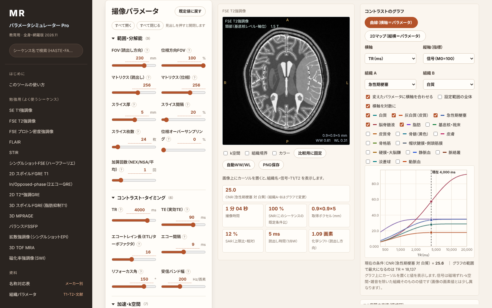
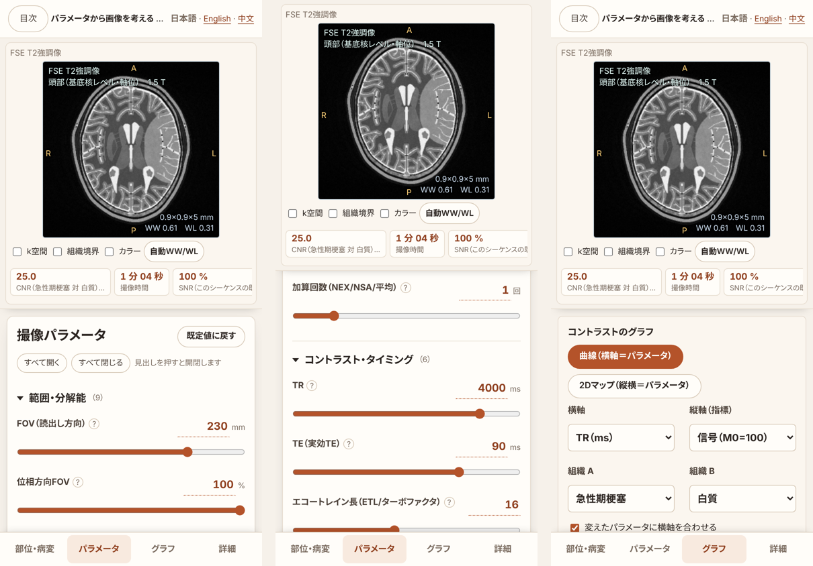
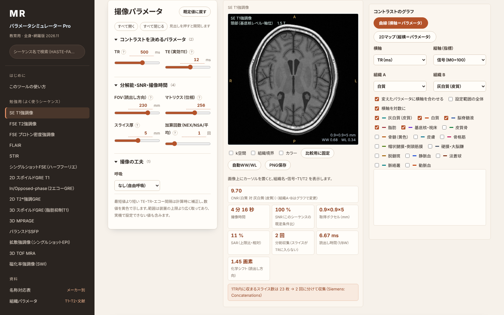

<h1 align="center">MRIパラメータシミュレーター Pro（全身・網羅版）</h1>

<p align="center">
  撮像パラメータを動かすと、<strong>仮想ファントムの画像・撮像時間・SNR・SAR・組織コントラストのグラフ</strong>がその場で変わる、<br>
  MRIの教育用シミュレーターです。HTMLファイル1つで、オフラインで動きます。
</p>

<p align="center">
  <a href="https://ringnir.github.io/MRI-SIMULATOR-html/"><strong>▶ ブラウザで開く</strong></a>
  　｜　
  <a href="https://ringnir.github.io/MRI-SIMULATOR-html/#learn"><strong>▶ 勉強用で開く</strong></a>
  　｜　
  <a href="index.html"><strong>HTMLファイル（ダウンロード）</strong></a>
  　｜　
  <a href="README.en.md">English</a> · <a href="README.zh-CN.md">中文</a>
</p>

<p align="center">
  
</p>

> [!WARNING]
> **教育用の近似モデルです。診療・装置の設定には使わないでください。** 組織値は文献値を丸めた代表値・推定値、仮想ファントムは解析的な図形で描いた模式図です。画像・撮像時間・SNR・SAR は装置の表示値を再現するものではありません。医療機器ではありません。

> [!NOTE]
> **非公式のツールです。** Siemens Healthineers・GE HealthCare・Philips・Canon Medical Systems・Fujifilm・United Imaging Healthcare とは関係ありません。メーカーのシーケンス名・機能名は、名称の対応を示す目的で記載しています（各社の商標または登録商標です）。名称はソフトウェアのバージョン・地域で異なることがあるので、お使いの装置のプロトコル名で確認してください。裏付けのとれていない名称は「—」としています。

---

## できること

|  | 内容 |
|---|---|
| 🧠 **仮想ファントム 12 種** | 頭部（基底核レベル・後頭蓋窩／内耳道・正中矢状）、胸部（心臓）、乳房、上腹部（膵体部・腎門）、骨盤（女性・男性）、腰椎、肩、膝。病変（梗塞・腫瘍・出血・脱髄・HCC・前立腺癌・骨髄浮腫・半月板断裂・金属など）を重ねて表示 |
| 🎛️ **シーケンス 60 種** | SE／FSE／IR、GRE、SSFP、拡散（DWI・DTI・RESOLVE・ズーム）、MRA（TOF・PC・FBI・Time-SLIP・QISS・造影）、心臓（シネ・LGE・MOLLI）、Dixon・PDFF、MRCP、ASL・BOLD・DSC、UTE、MRE、MRS など |
| 🔧 **ほぼ全パラメータ** | TR・TE・TI・フリップ角・ETL・エコー間隔・バンド幅・マトリクス・FOV・スライス、並列画像（GRAPPA／SENSE、CAIPIRINHA）・SMS・圧縮センシング・部分フーリエ・深層学習再構成、脂肪抑制、呼吸・心電図同期、造影の時相 |
| 📈 **コントラストのグラフ** | 横軸に任意のパラメータ、縦軸に信号・CNR・撮像時間・SAR など。現在値に縦線。2つのパラメータの 2D マップも |
| 🧩 **k空間の充填** | 取得したライン・並列の間引き・部分フーリエ・FSE のエコー番号・EPI の軌跡・ラジアルの模式図（エキスパート用） |
| 🖼️ **アーチファクト** | 折り返し、動き・拍動のゴースト、化学シフト、磁化率・金属、EPI の歪み、バンディング、並列画像の残存折り返し |
| 🏷️ **メーカー別の名称対応** | Siemens・Canon・GE・Philips・Fujifilm・United Imaging のシーケンス・オプション名（確認度つき） |
| 📱 **スマートフォン** | 画像と見積もりを上に固定し、下のタブで「部位・病変／パラメータ／グラフ／詳細」を切り替え |
| 🎨 **配色** | 標準・ライト・ダーク（読影室向け）・ウォーム（既定）を画面右上で切り替え |
| 🎓 **勉強用** | よく使う 15 シーケンスを、学習に必要なパラメータだけで。学習のポイントとプリセットつき |

<p align="center">
  
</p>

<p align="center">
  
</p>

## 使い方

- **URLから開く**：<https://ringnir.github.io/MRI-SIMULATOR-html/>
- **ファイルで使う**：[`index.html`](index.html) をダウンロードして、ブラウザ（Chrome・Edge・Safari・Firefox）で開くだけです。インストールもネット接続も要りません。入力した値はどこにも送信されません。
- `#learn` を付けると勉強用、`#expert` を付けるとエキスパート用で開きます。
- 英語版は [`en.html`](en.html)、中国語（簡体字）版は [`zh.html`](zh.html)。画面右上で切り替えられます。

画面の上の段で部位・病変・静磁場を選び、左のパラメータを動かすと、中央の画像と右のグラフが変わります。グラフの縦の破線が現在の値です。画像は上下左右のドラッグでウインドウ幅・レベル、ダブルクリックで自動に戻ります。パラメータの群は見出しを押すと開閉できます。

## しくみ（概要）

- 組織ごとの T1・T2・T2*・水素密度・ADC・脂肪分率・磁化率などから、シーケンスごとの信号式（SE、IR、スポイルド GRE、bSSFP の定常状態、MPRAGE／MP2RAGE の数値計算など）で信号を求めます。
- 1024² のラベル画像に描いた仮想ファントムを、FOV・位相方向で標本化し、k空間で エコートレインの減衰・動き・部分フーリエ・フィルタを加えてから画像に戻し、コイル感度・雑音・並列画像の g 因子を加えます。
- 計算はすべてブラウザの中（Web Worker）で行います。外部ライブラリは使っていません。

組織値の出典：Stanisz GJ, et al. MRM 2005（PMID 16086319）、de Bazelaire CMJ, et al. Radiology 2004（PMID 14990831）、Gold GE, et al. AJR 2004（PMID 15269023）、Wansapura JP, et al. JMRI 1999（PMID 10232510）、Rohrer M, et al. Invest Radiol 2005（PMID 16230904）。一部は推定値です（画面の「組織パラメータ」に出典つきで一覧）。

## 開発

```
src/            エンジンと画面（tissues.js 組織値、phantom.js ファントム共通部、ph/*.js ファントム、
                engine.js 信号・k空間・雑音、seqs.js シーケンス、state.js パラメータ、meta.js、learn.js 勉強用、ui.*）
css/            画面のスタイル
build.py        src/ と css/ を1つの HTML にまとめる
tests/          Node での試験（全ファントム×全シーケンス、ラベル図・画像の書き出し）
docs/EXTENDING.md     拡張のしかた（シーケンス・パラメータ・ファントム・メーカー名・勉強用・翻訳）
docs/PHANTOM_SPEC.md  ファントムの追加・修正のしかた
i18n/           英語・中国語の対訳（日本語の文字列 → 訳）。ビルド時にソースの文字列を置き換える
```

```
python3 build.py index.html --public            # 公開版（日本語）をビルド
python3 build.py en.html --public --lang=en     # 英語版
python3 build.py zh.html --public --lang=zh     # 中国語（簡体字）版
node tests/all.js                       # 全ファントム×全シーケンス×1.5/3T（数分）
node tests/learn_chk.js                 # 勉強用の設定の整合
```

## 拡張する

新しいシーケンス・技術・ファントムは、**ファイルを1つ足すだけ**で追加できます。`src/seq/*.js`（シーケンス）と `src/ph/*.js`（ファントム）は、ビルド時に自動で読み込まれます。

- シーケンス：`MS.addSeq({...})`。既存の信号式を使うなら数行です（例 [`src/seq/se_t2.js`](src/seq/se_t2.js)）。新しい信号式も `run` に書けます（例 [`src/seq/se_dual.js`](src/seq/se_dual.js)）
- パラメータ：`MS.addParam([...])`　勉強用：`MS.addLearn({...})`　分類：`MS.addCat(id, 名前)`
- 翻訳：ビルドで出る未訳の一覧（`i18n/missing_*.json`）に訳を足すだけ

詳しくは [docs/EXTENDING.md](docs/EXTENDING.md)。

## ライセンス

[MIT License](LICENSE)。第三者のソフトウェア・フォント・画像は含みません（文字は端末の游ゴシック・メイリオ等を使います）。
