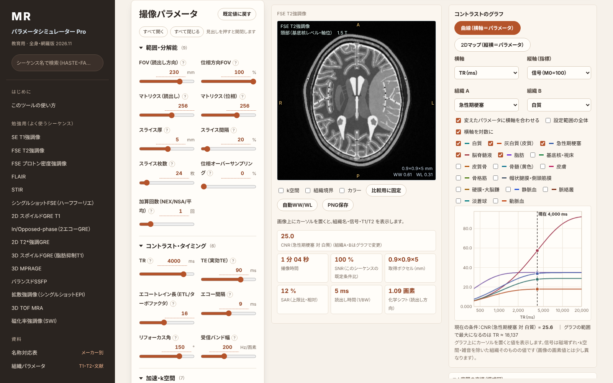

<h1 align="center">MRI 参数模拟器 Pro（全身版）</h1>

  调整扫描参数，<strong>虚拟体模图像、扫描时间、SNR、SAR 和组织对比度曲线</strong>即时变化。 
  一个 HTML 文件即可离线运行的 MRI 教学模拟器。

  <a href="https://ringnir.github.io/MRI-SIMULATOR-html/zh.html"><strong>▶ 在浏览器中打开</strong></a>
  　｜　
  <a href="https://ringnir.github.io/MRI-SIMULATOR-html/zh.html#learn"><strong>▶ 学习模式</strong></a>
  　｜　
  <a href="README.md">日本語</a> · <a href="README.en.md">English</a>

  

> [!WARNING]
> **仅为教学用近似模型，请勿用于临床诊断或设备参数设置。** 组织参数为文献值的取整代表值或估计值，虚拟体模为用解析图形绘制的示意图。图像、扫描时间、SNR、SAR 并不再现设备的显示值。本工具不是医疗器械。

> [!NOTE]
> **非官方工具。** 与 Siemens Healthineers、GE HealthCare、Philips、Canon Medical Systems、Fujifilm、United Imaging Healthcare 均无关联。各厂商的序列名与功能名仅用于说明对应关系，为各公司的商标或注册商标。名称可能因软件版本和地区而不同，请以所用设备的协议名称为准。无法确认的名称显示为“—”。

## 功能

| | |
|---|---|
| 🧠 **12 种虚拟体模** | 头部（基底节层面、后颅窝/内听道、正中矢状）、胸部（心脏）、乳腺、上腹部（胰体、肾门）、盆腔（女性、男性）、腰椎、肩关节、膝关节，可叠加病灶 |
| 🎛️ **60 种序列** | SE/FSE/IR、GRE、SSFP、扩散（DWI、DTI、读出分段、小视野）、MRA（TOF、PC、FBI、Time-SLIP、QISS、增强 MRA）、心脏（电影、LGE、MOLLI）、Dixon/PDFF、MRCP、ASL、BOLD、DSC、UTE、MRE、MRS |
| 🔧 **几乎全部参数** | TR、TE、TI、翻转角、回波链长度、回波间隔、带宽、矩阵、FOV、层数；并行成像（GRAPPA/SENSE、CAIPIRINHA）、SMS、压缩感知、部分傅里叶、深度学习重建；脂肪抑制；呼吸/心电门控；增强时相 |
| 📈 **对比度曲线** | 横轴可选任意参数，纵轴为信号、CNR、扫描时间或 SAR，并标出当前值；也可显示两个参数的二维图 |
| 🧩 **k 空间填充** | 采集线、并行成像欠采样、部分傅里叶、FSE 回波顺序、EPI 轨迹、放射状采集示意（专家模式） |
| 📱 **手机布局** | 图像与估算值固定在上方，底部标签切换“部位·病灶／参数／曲线／详情” |
| 🏷️ **厂商名称对照** | Siemens、Canon、GE、Philips、Fujifilm、United Imaging（附确认程度） |
| 🎓 **学习模式** | 15 种常用序列，只显示学习所需参数，附要点与预设 |

## 使用方法

- **在线打开：** <https://ringnir.github.io/MRI-SIMULATOR-html/zh.html>
- **作为文件使用：** 下载 [`zh.html`](zh.html)，用 Chrome、Edge、Safari 或 Firefox 打开即可。无需安装或联网，输入的数值不会发送到任何地方。
- 网址末尾加 `#learn` 为学习模式，加 `#expert` 为专家模式。

## 许可

[MIT License](LICENSE)。不包含第三方代码、字体或图像。
